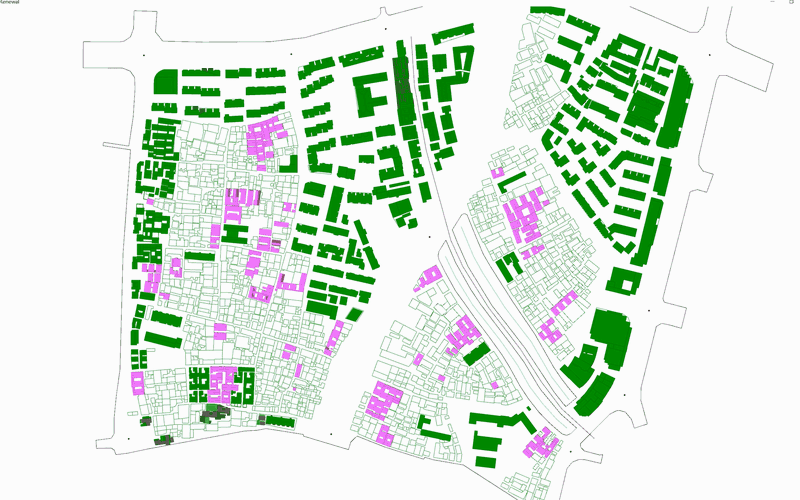
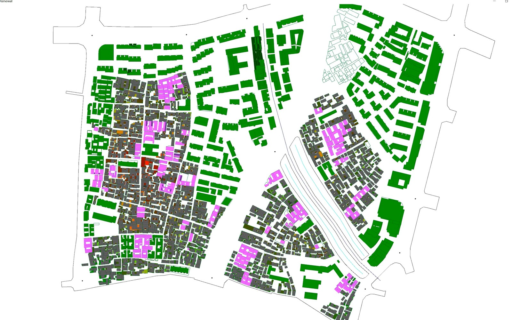

# Riverfront Urban Design

**滨水街区与传统院落的 Java 计算设计研究原型。**

**项目完成时间：2024 年 12 月。** 设计研究、原始程序与课程成果于该时完成；当前仓库另包含后续的发布整理与兼容性修复。

将沿线地块划分、公共空间可达性、多目标方案搜索与院落类型生成连接起来，使用 iGeo 与 Rhino 交换几何。代码源于 2024 年城市设计课程项目，此版本整理了构建依赖、独立示例和部分直接影响运行的错误。

> Java-based urban-design research prototype combining riverfront parcel generation, network accessibility, multi-objective evaluation and rule-based courtyard typologies.
>
> Original project completed in **December 2024**. This repository also includes subsequent release preparation and compatibility fixes.



展示图来自原课程成果动画，经缩放和抽帧压缩。它们展示历史设计成果，不代表此次重新运行并验证了完整场地优化。

[查看院落近景动画与完整图集](docs/GALLERY.md)

## 可以做什么

| 模块 | 内容 |
| --- | --- |
| 院落类型 | 按面宽、进深、入口和层数模式，组合正房、院墙及厢房 |
| 沿河地块 | 沿脊线设置种子，进行裁剪 Voronoi 划分，并关联类型与层数 |
| 公共空间评价 | 估算到公共空间的路网最短距离，以及开敞边张角代理指标 |
| 多目标搜索 | 通过 jMetal NSGA-II 搜索面积、距离、层数起伏等指标之间的取舍 |
| 地块更新 | 按可达性筛选地块，搜索近似最大内接矩形，再生成院落 |

## 快速开始：不需要原始场地数据

默认示例 `examples.SyntheticCourtyardDemo` 在内存中构造六个矩形地块，调用原有院落类和随包门窗构件，导出模型。生成过程不需要安装 Rhino，也不启动 Processing 窗口；查看 `.3dm` 结果需要兼容查看器。

环境与命令见 [运行说明](docs/RUNNING.md)。首次构建需要联网下载 Maven 依赖。

```powershell
# 在仓库根目录运行；需要 JDK 23，Maven Wrapper 会准备 Maven
.\mvnw.cmd clean verify
.\mvnw.cmd exec:java
```

生成文件位于 `output/demo/`：

- `courtyard-demo.3dm`：六个院落，各自分层，包含参数化门窗。
- `run-summary.json`：尺寸、类型标识、层数模式及几何对象数量。

这些文件是本地运行产物，已被 Git 忽略，不在发布压缩包中。

自定义一个院落：

```powershell
.\mvnw.cmd exec:java "-Dexec.args=14 18 1.5"
```

参数依次为面宽、进深、层数模式。示例支持面宽 5–20 m、进深 10–30 m，以及 `1`、`1.5`、`2`。其中 `1.5` 延续原项目的前后不同层数组合语义，不表示所有房屋都有半层。

## 展示与代码结构



```text
assets/components/       门窗构件（唯一随包 .3dm）
lib/                     必要的历史 Java 二进制依赖
docs/                    运行、数据约定、检查记录、压缩展示媒体
src/main/java/
  examples/              可独立运行的合成地块示例
  Typologies/            场地坐标与院落建筑规则
  NSGAII/                地块生成、目标函数及早期实验
  Spacesyntax/           路网几何、最短路径与格式转换
  Zshare/                保留原署名的共享几何工具
  basic/                 辅助向量与 ArchiJSON 适配代码
src/test/java/           历史场地入口及回归测试
```

原南岸、北岸和更新入口仍用于研究复现，依赖未随包分发的场地模型。参见 [私有数据约定](docs/PRIVATE_DATA.md)。`NSGAII.test01/test02`、旧散点可视化和 `org.example.Main` 是历史实验，不是默认启动入口。

## 指标与适用边界

- 可达性使用路网最短距离；未实现完整的空间句法整合度、选择度或 VGA。
- 开敞度是二维开敞边张角的代理值，没有计算三维遮挡。
- `deltaHeight` 是相邻地块层数差绝对值之和，不能直接当作日照或天际线品质。
- 建筑面积仍主要使用类型规则估算，并未全面替换为生成几何逐层核算。
- 内接矩形使用启发式搜索，不保证数学上的全局最优。
- 完整场地优化仍属于研究原型；当前发布重点是可构建的代码和不依赖私有数据的院落示例。验证范围及剩余问题见 [检查记录](docs/CODE_REVIEW.md)。

## 数据、来源与许可

仓库不分发原始场地 `.3dm`、结果 `.csv`、ArchiJSON 数据、编译缓存或完整历史模型，仅保留门窗构件和压缩成果展示。`.gitignore` 对这些文件做了默认排除。

共享几何代码、ArchiJSON 适配器与依赖库保留各自来源和作者信息。本整理版没有将第三方代码重新声明为 MIT 等许可证；使用和再分发前应核实相应授权。详见 [第三方来源说明](THIRD_PARTY_NOTICES.md)。
