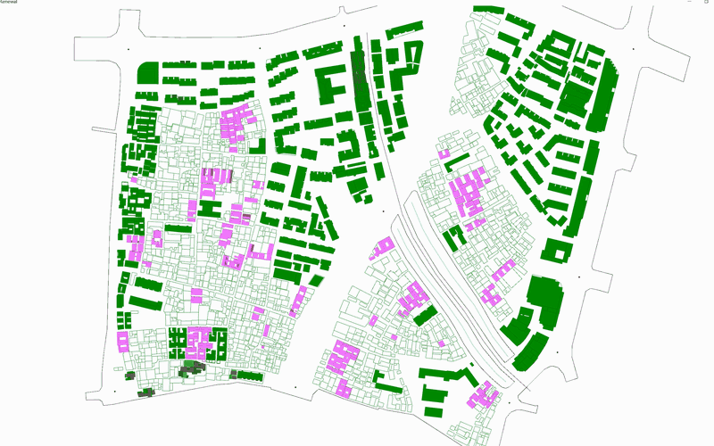
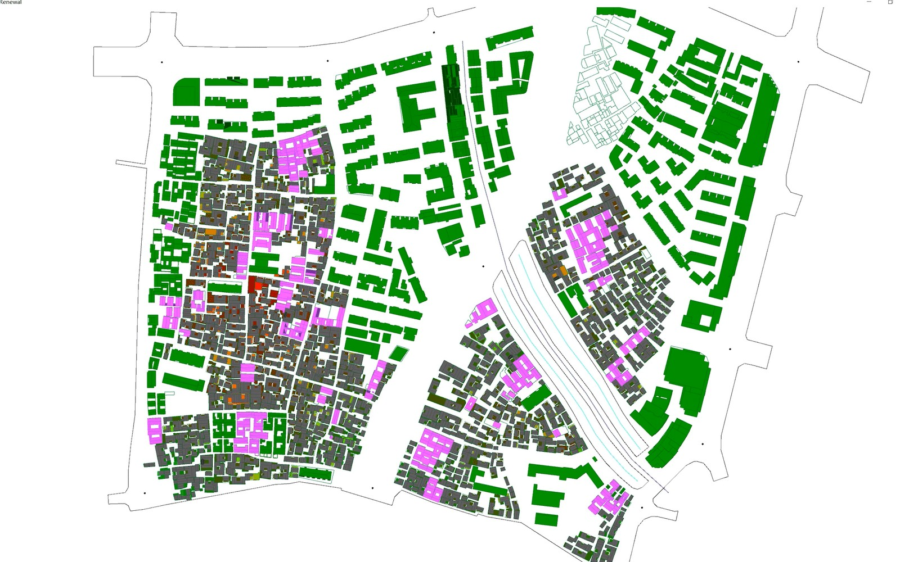
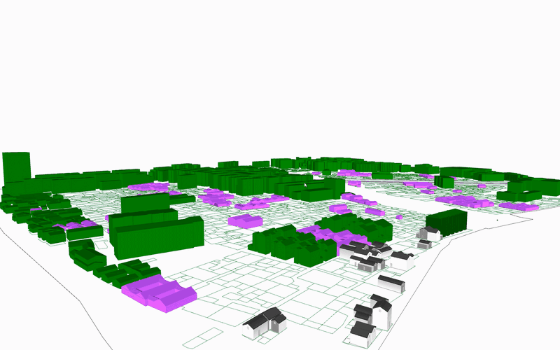
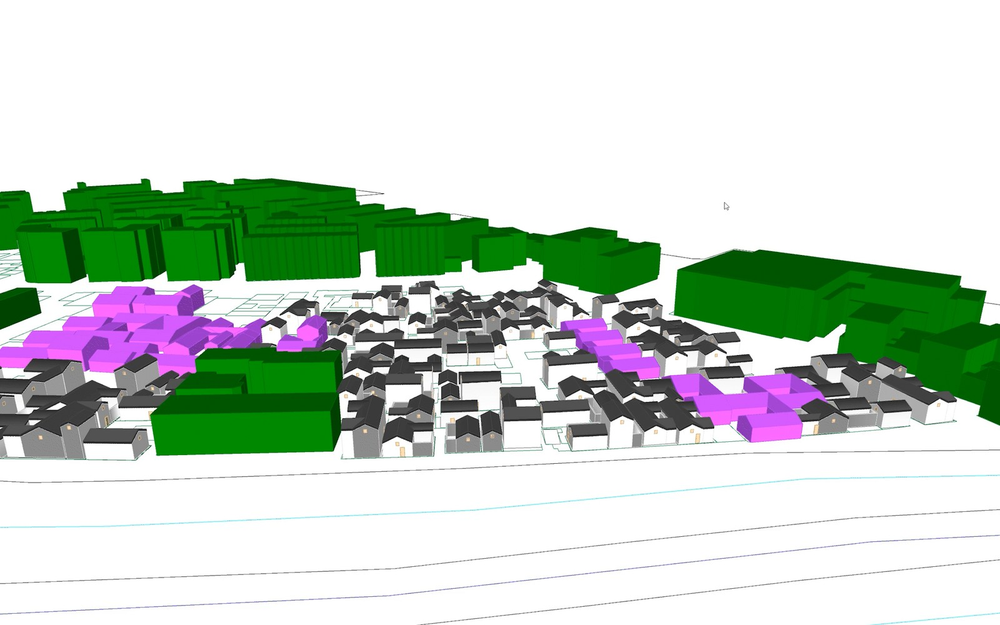

# 历史课程成果展示

原项目与课程成果完成于 **2024 年 12 月**。

以下动画与静帧来自原项目的成果记录。为降低仓库体积，GIF 经缩放、抽帧及调色板压缩，仍保留完整时长和循环。它们不是本整理版重新执行完整场地优化后的验证截图。

## 街区生成

## 院落近景

文件来源、尺寸、时长、压缩方法见 [媒体记录](media/media-notes.json)。完整原始动画没有放入仓库。
